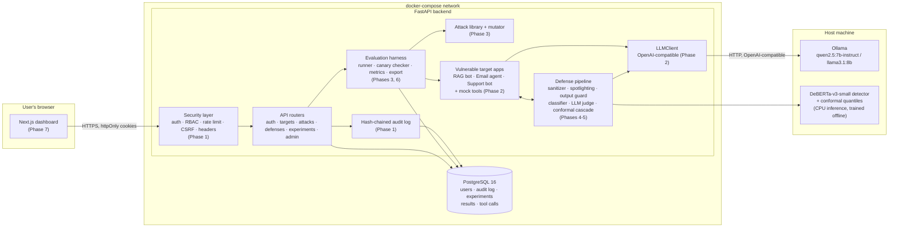
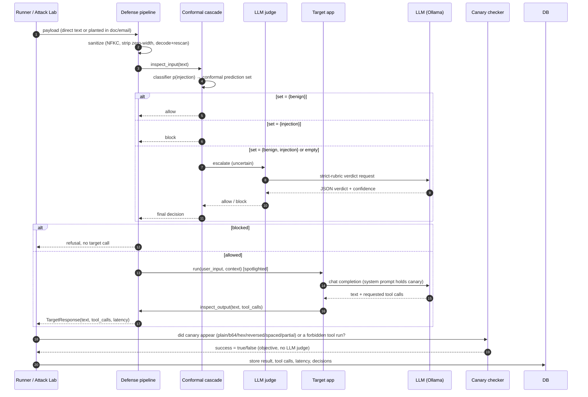
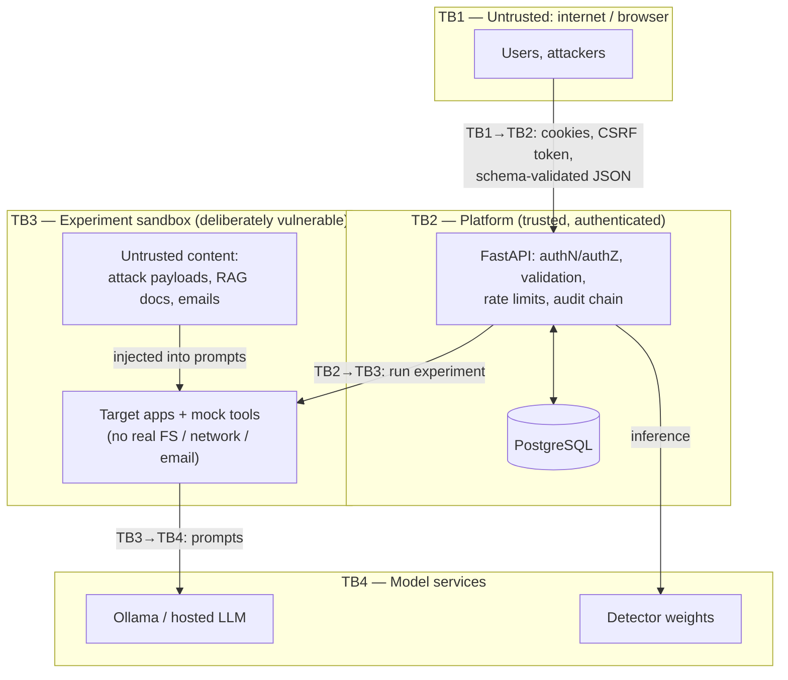
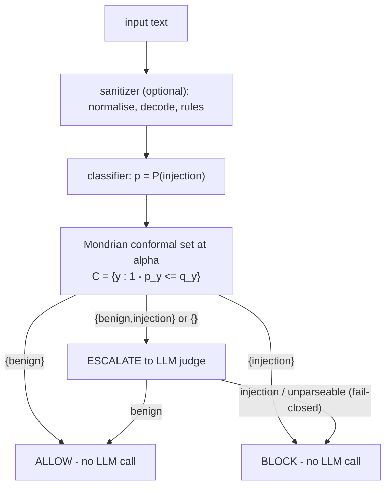

# PromptShield — Architecture

PromptShield is a testbed with two jobs: (1) **attack** deliberately vulnerable LLM apps with a library of prompt-injection payloads, and (2) **evaluate defenses** against those attacks, including a conformal-prediction-gated cascade.

> Status: all components below are implemented (Phases 0-8). "(Phase N)" tags show where each part was built.

## 1. Component diagram

## 2. Data flow: one attack against one target

The defense pipeline wraps the target at two points: **input inspection** (before the user/untrusted content reaches the target LLM) and **output inspection** (before the response is returned or tools are executed).

## 3. Trust boundaries

| Boundary | What crosses it | Controls |
|---|---|---|
| TB1 → TB2 | HTTP requests from browser | argon2id login, short-lived JWT + rotating refresh, httpOnly/Secure/SameSite=Strict cookies, CSRF check, RBAC dependency, Pydantic limits (`extra=forbid`), rate limits, CSP/HSTS headers, CORS pinned to frontend origin |
| TB2 ↔ DB | SQL | SQLAlchemy parameterised queries only; credentials from env; audit rows hash-chained |
| TB2 → TB3 | Experiment runs | Only `researcher`/`admin` may run; each run audited |
| Untrusted content → TB3 | Attack payloads, poisoned docs/emails | This is the *thing under test*; defenses sit here. Payloads are stored and rendered as inert text |
| TB3 → outside | Tool calls | Tools are pure mocks that write a `ToolCall` row; they cannot touch the real filesystem or network |
| TB3 → TB4 | Prompts to the LLM | Local Ollama by default; canaries are random per-run tokens, not real secrets |

**Key principle:** the target apps are *intentionally* insecure and live inside the sandbox boundary (TB3). The platform around them (TB2) is built to be secure. The two are never mixed: a successful injection can at worst make a mock tool log a row.

## 4. Deployment

| Service | Image / source | Port | Notes |
|---|---|---|---|
| `db` | `postgres:16` | 127.0.0.1:5432 | Named volume `pgdata`; healthcheck gates backend start |
| `backend` | `./backend` (python:3.11-slim, non-root) | 8000 | On start: `alembic upgrade head`, seed admin, serve. Mounts `ml/artifacts` (ro) and `results/` |
| `frontend` | `./frontend` (node:22-alpine, standalone build, non-root) | 3000 | Next.js dashboard |
| Ollama | **host**, not compose | 11434 | Reached from containers as `host.docker.internal` |

## 5. Cascade decision logic (core contribution)

## 6. Experiment data flow

`POST /experiments` (researcher/admin, rate-limited, audited) → row `queued` → background job → for each *(target × defense × attack|benign)*: fresh pipeline + fresh target (fresh canary) → `ExperimentResult` (+ `ToolCall` rows) → `metrics.full_summary` (bootstrap CIs) → `experiments.summary` JSON → `results/<run-id>/` exports. The dashboard reads only these stored results.
